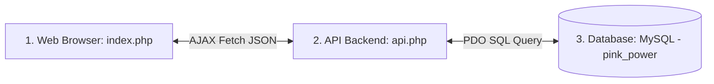

# โครงสร้างและสถาปัตยกรรมของเว็บไซต์ (Pink Power Web Structure)

เอกสารนี้ระบุโครงสร้างการทำงาน รูปแบบฐานข้อมูล โครงสร้างเมนูหน้าเว็บ (UI/UX) และกฎเกณฑ์ (Business Logic) ทั้งหมดของระบบจัดเวรคณะสีชมพู เพื่อใช้อ้างอิงในการออกแบบเว็บไซต์ใหม่

---

## 1. ภาพรวมสถาปัตยกรรม (Architecture Overview)

ระบบทำงานในรูปแบบ **Client-Server Architecture** บน XAMPP (Local Host):

1. **Frontend (`index.php`)**: หน้าจอหลักขับเคลื่อนด้วย HTML, CSS (Bootstrap 5) และ JavaScript (จัดการ Logic การคำนวณเวร, การตรวจสอบกฎเกณฑ์, จัดการ Tab UI และการส่งออกไฟล์ Word)
2. **Backend (`api.php`)**: ทำหน้าที่เป็นตัวกลางเชื่อมต่อฐานข้อมูล ตรวจสอบสถานะการเชื่อมต่อ และรับ-ส่งข้อมูลในรูปแบบ JSON
3. **Database (`schema.sql`)**: ฐานข้อมูล MySQL ชื่อ `pink_power` ประกอบด้วยตารางข้อมูลดิบ (ครู, ภาระงาน) และตารางบันทึกผลเวร

---

## 2. โครงสร้างฐานข้อมูล (Database Schema)

ฐานข้อมูลประกอบด้วย 3 ตารางหลัก ดังนี้:

### 2.1 ตารางคุณครู (`teachers`)
เก็บข้อมูลรายชื่อและเพศของคุณครู
* `id` (INT, Primary Key, Auto Increment)
* `fullname` (VARCHAR(255), ชื่อ-นามสกุลจริง)
* `gender` (ENUM('M', 'F'), เพศ: M = ชาย, F = หญิง)

### 2.2 ตารางภาระงานเวร (`duties`)
เก็บรายชื่อจุดปฏิบัติเวรและระดับความเข้มข้น
* `id` (INT, Primary Key, Auto Increment)
* `name` (VARCHAR(255), ชื่อจุดเวรและเวลาปฏิบัติงาน)
* `level` (ENUM('High', 'Medium', 'Low'), ระดับภาระงาน: เข้มข้น, ปานกลาง, ทั่วไป)
* `icon` (VARCHAR(50), ไอคอนอิโมจิแสดงผล เช่น ☀️, 🌙, 🍽️)

### 2.3 ตารางบันทึกผลการจัดเวร (`schedule`)
เก็บผลลัพธ์เวรที่ถูกบันทึกลงเซิร์ฟเวอร์
* `week_index` (INT, ดัชนีรอบสัปดาห์ที่ 0 - 9)
* `duty_id` (INT, Foreign Key -> `duties.id`)
* `teacher_id` (INT, Foreign Key -> `teachers.id`)
* *หมายเหตุ: ใช้ค่า Composite Primary Key ร่วมกันระหว่าง (`week_index`, `duty_id`)*

---

## 3. โครงสร้างและองค์ประกอบของหน้าเว็บ (Frontend UI Structure)

หน้าเว็บแบ่งส่วนประกอบเป็นส่วนหลักๆ ดังนี้:

### 3.1 แถบส่วนหัว (Header Panel)
* **โลโก้และชื่อระบบ**: "Pink Power | ระบบบริหารจัดการเวร คณะสีชมพู"
* **ปุ่มดำเนินการหลัก (Action Buttons)**:
  * ปุ่ม `สุ่มใหม่ล่วงหน้าทั้งปี` (สุ่มตารางเวรทั้งหมด 10 รอบใหม่ตามกฎเกณฑ์)
  * ปุ่ม `บันทึกลงเซิร์ฟเวอร์` (บันทึกข้อมูลตารางลงฐานข้อมูล MySQL) *มีลูกเล่นไฟกะพริบ (Pulsing) เมื่อข้อมูลมีการเปลี่ยนแปลงแต่ยังไม่ได้บันทึก*

### 3.2 การ์ดข้อมูลสถิติ (Stats Grid - 4 KPI Cards)
1. **จำนวนรอบปฏิบัติงาน**: แสดงจำนวน "10 รอบปฏิบัติงาน"
2. **จำนวนครู (กำลังพล)**: ดึงข้อมูลสรุปมาแสดง เช่น "30 ท่าน (ชาย 4 | หญิง 26)"
3. **จำนวนจุดเวร (ภาระงาน)**: ดึงข้อมูลสรุปมาแสดง เช่น "30 หน้าที่ (เข้มข้น 12 | ปานกลาง 9 | ทั่วไป 9)"
4. **สถานะการเชื่อมต่อ (Sync Status)**: แสดงจุดสีเขียว 🟢 "เชื่อมต่อสำเร็จ" หรือจุดสีส้ม 🟠 "รอการบันทึก" หรือจุดสีแดง 🔴 "เชื่อมต่อล้มเหลว" โดยตรวจสอบจากสถานะเชื่อมต่อ MySQL ของ backend

### 3.3 ระบบแท็บเมนู (Tab Pills Navigation)
แบ่งหน้าต่างแสดงผลออกเป็น 4 แท็บหลัก:

#### 1) แท็บตารางรวมครู (Overview Grid)
* แสดงตารางสรุปโดยมี **แถวเป็นรายชื่อครู (30 แถว)** และ **คอลัมน์เป็นรอบปฏิบัติงาน (รอบที่ 1-10)**
* ช่องตาราง (Cell) แสดงไอคอนประเภทเวร (☀️/🍽️/🌙) และชื่อเวรย่อ โดยใส่สีพื้นหลังแบ่งตามระดับความเข้มข้น (ฟ้า/เขียว/ส้ม) เพื่อให้ตรวจเช็คด้วยตาได้ง่ายว่าครูคนใดมีเวรวันไหน
* คอลัมน์ "รายชื่อคุณครู" จะเป็นแบบตรึงอยู่กับที่ (Sticky Column) เมื่อเลื่อนดูตารางทางขวา

#### 2) แท็บตารางรายหน้าที่ (Duty View Grid)
* แสดงตารางโดยมี **แถวเป็นรายการหน้าที่ (30 แถว)** และ **คอลัมน์เป็นรอบปฏิบัติงาน (รอบที่ 1-10)**
* ช่องตาราง (Cell) แสดงชื่อครูที่ได้รับมอบหมายในหน้าที่นั้นๆ ในรอบสัปดาห์นั้น
* มีสัญลักษณ์ปุ่ม 🔄 ที่หัวคอลัมน์ เพื่อสุ่มเวรใหม่เฉพาะสัปดาห์นั้นๆ ได้อย่างอิสระ

#### 3) แท็บส่งออกคำสั่ง Word (Weekly Export)
* ตัวเลือกดรอปดาวน์เลือกสัปดาห์ (รอบที่ 1 ถึง 10)
* ตารางพรีวิวแสดงลำดับ, ชื่อครู, ภารกิจหน้าที่, และระดับความเข้มข้นของสัปดาห์ที่เลือก
* ช่องกรอกข้อมูล "วันและสัปดาห์ปฏิบัติงาน" (เพื่อไปแทนที่ในข้อความคำสั่งราชการ)
* ปุ่ม `ดาวน์โหลด Word (.doc)` สำหรับส่งออกไฟล์คำสั่งอย่างเป็นทางการ (จัดฟอร์มมาตรฐานหนังสือราชการ ใช้ฟอนต์ TH Sarabun New)

#### 4) แท็บรายงานการกระจายงาน (Workload Analysis)
* การ์ดสรุปเป้าหมายภาระงานสูงสุดที่ครูแต่ละคนควรได้รับต่อปี:
  * เวรเข้มข้น (High): ไม่เกิน 4 รอบ/คน
  * เวรปานกลาง (Medium): ไม่เกิน 3 รอบ/คน
  * เวรทั่วไป (Low): ไม่เกิน 3 รอบ/คน
* ตารางแสดงรายชื่อครูทุกคน พร้อมแถบหลอดพลังความคืบหน้า (Progress Bar) แสดงจำนวนงานจริงที่ได้รับมอบหมายเทียบกับโควตาสูงสุด เพื่อตรวจเช็คความเท่าเทียม (Workload Balance)

---

## 4. กฎเกณฑ์การจัดเวรแบบพิเศษ (Scheduling Rules & Business Logic)

นี่คือกฎทางเทคนิค (Business Logic) ที่ระบบจัดเวรต้องคำนวณและประมวลผลโดยอัตโนมัติ:

1. **กฎลานธรรม (Lan Dham Rule)**:
   * คุณครู "ศิริวรรณ" และคุณครู "นัชนันท์" จะผลัดกันรับเวรที่จุด "9.1 ลานธรรม (08.00)" สัปดาห์เว้นสัปดาห์ (สัปดาห์คู่คนหนึ่ง สัปดาห์คี่อีกคนหนึ่ง)
   * คนที่ไม่ได้อยู่เวรลานธรรมในสัปดาห์นั้น จะต้องถูกสุ่มให้ไปลงเวรระดับทั่วไป (Low) หรือปานกลาง (Medium) แทน เพื่อไม่ให้ว่างงาน
2. **กฎการเกษียณอายุของคุณครูบุญมา (Boonma Retirement Rule)**:
   * คุณครู "บุญมา" จะปฏิบัติหน้าที่จุดเวรจราจร "7.1 จราจรป้ายใหม่ (เช้า)" ในรอบที่ 1 - 5 เท่านั้น
   * ตั้งแต่รอบที่ 6 เป็นต้นไป (เนื่องจากเกษียณอายุราชการ) จะไม่มีการจัดเวรใดๆ ให้คุณครูบุญมาอีกเลย
3. **กฎเพศของงานจราจร (Traffic Gender Lock)**:
   * จุดเวรจราจร ได้แก่ "7.1 จราจรป้ายใหม่ (เช้า)" และ "7.2 จราจรป้ายเก่า (เช้า)" จะต้องจัดให้เฉพาะ **ครูเพศชาย (Male)** เท่านั้นปฏิบัติหน้าที่
   * ห้ามจัดครูที่เพิ่งทำหน้าที่จราจรในสัปดาห์ก่อนหน้า มาทำหน้าที่จราจรซ้ำในสัปดาห์ถัดไปทันที (ป้องกันการทำงานหนักติดต่อกัน)
4. **กฎการกระจายงานเฉลี่ยทั่วไป (Workload Balance Rule)**:
   * ในการสุ่มเวรแต่ละสัปดาห์ ระบบจะเลือกครูที่ชั่วโมงเวรรวม (ในระดับความเข้มข้นนั้นๆ) ยังไม่เต็มโควตาขึ้นมาก่อนเป็นอันดับแรก
   * หลีกเลี่ยงไม่ให้ครูคนเดิมถูกจัดเวรจุดเดิมซ้ำสองสัปดาห์ติดต่อกันในเวรระดับทั่วไป (Low)

---

## 5. รายละเอียดของฝั่งเซิร์ฟเวอร์ (Backend & Server Operations)

ตัวระบบทำงานผ่านไฟล์ `api.php` โดยมีหน้าที่รับส่งคำสั่งดังนี้:

* **การเรียกข้อมูลแบบ GET**:
  * เชื่อมต่อ MySQL ตรวจเช็คว่าฐานข้อมูลและตารางพร้อมใช้งานหรือไม่
  * หากไม่มีฐานข้อมูล ให้ทำการรัน `schema.sql` เพื่อสร้างตารางและกรอกข้อมูลเริ่มต้น (Seeding) ทันที
  * ส่งข้อมูล JSON ของรายชื่อครู รายการหน้าที่ และตารางเวร 10 รอบกลับมายังหน้าบ้าน
* **การส่งข้อมูลแบบ POST (บันทึกข้อมูล)**:
  * รับ JSON ตารางเวร 10 รอบ (`masterSchedule`) จากหน้าบ้าน
  * ทำการล้างตารางเวรเดิม (`DELETE FROM schedule`)
  * เขียนข้อมูลชุดใหม่เข้าไปโดยทำงานผ่านระบบ Transaction เพื่อความปลอดภัยของข้อมูล
